<!-- Generated from profile.config.json. Edit the source, then run npm run generate. -->

<picture>
  <source media="(max-width: 600px)" srcset="./themes/main/assets/hero-architect-mobile.svg">
  <source media="(prefers-reduced-motion: reduce)" srcset="./themes/main/assets/hero-architect-static.svg">
  
</picture>

  
  
  
  
  

<h2></h2>


<picture>
  <source media="(prefers-reduced-motion: reduce) and (max-width: 900px)" srcset="./themes/main/assets/console-pair-mobile-static.svg">
  <source media="(prefers-reduced-motion: reduce)" srcset="./themes/main/assets/console-pair-static.svg">
  <source media="(max-width: 900px)" srcset="./themes/main/assets/console-pair-mobile.svg">
  
</picture>

<h2></h2>


<h2></h2>


Frontend architecture, Angular, TypeScript, RxJS and NgRx; enterprise UI engineering, component systems and automated testing.

<h2></h2>


Researching how LLM applications use tools and retrieval, and where evaluation and human review fit in the workflow.

<h2></h2>

[**Angular architecture study**](https://github.com/AshutoshChoubey/angular-interview-worldgyan.com) — Angular signals, HTTP interceptors, and application structure.

[**RxJS operator lab**](https://github.com/AshutoshChoubey/rxjs-interview-worldgyan.com) — Higher-order mapping operators and reactive search.


[**NgRx effects demo**](https://github.com/AshutoshChoubey/ngrxeffects) — NgRx actions, reducers, and HTTP effects in a PokéAPI demo.

[**TypeScript type-system examples**](https://github.com/AshutoshChoubey/typescript-interview-worldgyan.com) — Generics, unions, mapped types, and utility types.

<h2></h2>

<picture>
  <source media="(prefers-reduced-motion: reduce) and (max-width: 900px)" srcset="./assets/rendered/static/7941401e25aa/github-activity-mobile.svg">
  <source media="(prefers-reduced-motion: reduce)" srcset="./assets/rendered/static/473de4dd6474/github-activity.svg">
  <source media="(max-width: 900px)" srcset="./assets/rendered/de1698d08ae2/github-activity-mobile.svg">
  
</picture>

[View contribution activity on GitHub](https://github.com/AshutoshChoubey#contribution-activity).

<picture>
  <source media="(prefers-reduced-motion: reduce) and (max-width: 900px)" srcset="./assets/rendered/static/583ee906d9e5/github-languages-mobile.svg">
  <source media="(prefers-reduced-motion: reduce)" srcset="./assets/rendered/static/d93cec50cc66/github-languages.svg">
  <source media="(max-width: 900px)" srcset="./assets/rendered/f4d253faf63d/github-languages-mobile.svg">
  
</picture>

<picture>
  <source media="(prefers-reduced-motion: reduce)" srcset="./themes/main/assets/github-jet-static.svg">
  
</picture>

<picture>
  <source media="(prefers-reduced-motion: reduce)" srcset="./themes/main/assets/contribution-snake-static.svg">
  
</picture>

<h2></h2>


 

- **Frontend System Design** · [Read research paper](https://worldgyan.com/technology/frontend-system-design/)
- **Agentic AI Engineering** · [Read research paper](https://worldgyan.com/technology/production-ai-engineering/)
- **Angular Testing Tutorials** · [Watch video series](https://www.youtube.com/playlist?list=PLqQyE6QNucSfUIpucL_nx7vDuwAa1A_VH)

<h2></h2>

  
  
  
  
  
  

[Cyber-Architect](./themes/cyber-architect/README.md)

<b>Design Documentation &amp; Accessibility</b>

<picture>
  <source media="(prefers-reduced-motion: reduce) and (max-width: 900px)" srcset="./assets/rendered/static/18edc4f70f5f/hero-mobile.svg">
  <source media="(prefers-reduced-motion: reduce)" srcset="./assets/rendered/static/d1199b2335e5/hero.svg">
  <source media="(max-width: 900px)" srcset="./assets/rendered/f09b6fcb0ac0/hero-mobile.svg">
  
</picture>

**Ashutosh Kumar Choubey · Senior Software Engineer** 
Frontend Architecture · System Design · AI Orchestration

<picture>
  <source media="(prefers-reduced-motion: reduce) and (max-width: 900px)" srcset="./assets/rendered/static/cce821112ced/expertise-mobile.svg">
  <source media="(prefers-reduced-motion: reduce)" srcset="./assets/rendered/static/2b4b139111b8/expertise.svg">
  <source media="(max-width: 900px)" srcset="./assets/rendered/81659348a649/expertise-mobile.svg">
  
</picture>

<picture>
  <source media="(prefers-reduced-motion: reduce) and (max-width: 900px)" srcset="./assets/rendered/static/03bbd1e35f14/technology-mobile.svg">
  <source media="(prefers-reduced-motion: reduce)" srcset="./assets/rendered/static/023dea640ced/technology.svg">
  <source media="(max-width: 900px)" srcset="./assets/rendered/801faa005b3a/technology-mobile.svg">
  
</picture>

<picture>
  <source media="(prefers-reduced-motion: reduce) and (max-width: 900px)" srcset="./assets/rendered/static/9719c72acc87/ai-systems-mobile.svg">
  <source media="(prefers-reduced-motion: reduce)" srcset="./assets/rendered/static/827f07c90255/ai-systems.svg">
  <source media="(max-width: 900px)" srcset="./assets/rendered/46820306bbac/ai-systems-mobile.svg">
  
</picture>

<picture>
  <source media="(prefers-reduced-motion: reduce) and (max-width: 900px)" srcset="./assets/rendered/static/56d69706f545/research-mobile.svg">
  <source media="(prefers-reduced-motion: reduce)" srcset="./assets/rendered/static/28a25a9d8999/research.svg">
  <source media="(max-width: 900px)" srcset="./assets/rendered/06e407e1cc76/research-mobile.svg">
  
</picture>

<picture>
  <source media="(prefers-reduced-motion: reduce) and (max-width: 900px)" srcset="./assets/rendered/static/72e54942992f/connect-mobile.svg">
  <source media="(prefers-reduced-motion: reduce)" srcset="./assets/rendered/static/fb938fa18060/connect.svg">
  <source media="(max-width: 900px)" srcset="./assets/rendered/71c1f5b19c16/connect-mobile.svg">
  
</picture>

