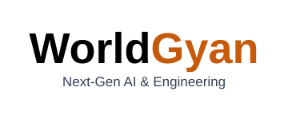

<!-- Preserved Classic Engineering Minimal Theme specification for Ashutosh Kumar Choubey -->

# Classic Engineering Minimal

[Main profile](../../README.md) · [Cyber-Architect](../cyber-architect/README.md) · [Obsidian Architect](../obsidian-architect/README.md)

<picture>
  <source media="(prefers-reduced-motion: reduce) and (max-width: 900px)" srcset="./assets/static/hero-mobile.svg">
  <source media="(prefers-reduced-motion: reduce)" srcset="./assets/static/hero.svg">
  <source media="(max-width: 900px)" srcset="./assets/hero-mobile.svg">
  
</picture>

**Ashutosh Kumar Choubey · Senior Software Engineer** 
Frontend Architecture · System Design · AI Orchestration

  
  
  
  
  

<picture>
  <source media="(prefers-reduced-motion: reduce) and (max-width: 900px)" srcset="./assets/static/expertise-mobile.svg">
  <source media="(prefers-reduced-motion: reduce)" srcset="./assets/static/expertise.svg">
  <source media="(max-width: 900px)" srcset="./assets/expertise-mobile.svg">
  
</picture>

<picture>
  <source media="(prefers-reduced-motion: reduce) and (max-width: 900px)" srcset="./assets/static/technology-mobile.svg">
  <source media="(prefers-reduced-motion: reduce)" srcset="./assets/static/technology.svg">
  <source media="(max-width: 900px)" srcset="./assets/technology-mobile.svg">
  
</picture>

**Established expertise:** Frontend architecture, Angular, TypeScript, RxJS and NgRx; enterprise UI engineering, component systems and automated testing.

**Currently building:** Public engineering studies and teaching examples in Angular, reactive workflows, state management and TypeScript.

<picture>
  <source media="(prefers-reduced-motion: reduce) and (max-width: 900px)" srcset="./assets/static/ai-systems-mobile.svg">
  <source media="(prefers-reduced-motion: reduce)" srcset="./assets/static/ai-systems.svg">
  <source media="(max-width: 900px)" srcset="./assets/ai-systems-mobile.svg">
  
</picture>

**Research focus:** Retrieval, tool-using language models, workflow evaluation and human review.

### Selected engineering projects

Public learning projects and code references.

- [**Angular architecture study**](https://github.com/AshutoshChoubey/angular-interview-worldgyan.com) — Study guides and TypeScript examples for Angular signals, HTTP interceptors, authentication flows and application architecture.
- [**RxJS operator lab**](https://github.com/AshutoshChoubey/rxjs-interview-worldgyan.com) — Angular demonstrations comparing switchMap, mergeMap, concatMap and exhaustMap, with a reactive search example.
- [**NgRx effects demo**](https://github.com/AshutoshChoubey/ngrxeffects) — An Angular PokéAPI example connecting store actions, reducers and HTTP side effects to list and detail views.
- [**TypeScript type-system examples**](https://github.com/AshutoshChoubey/typescript-interview-worldgyan.com) — Focused examples of generics, unions, mapped types and utility types, alongside a type-system study reference.

<picture>
  <source media="(prefers-reduced-motion: reduce) and (max-width: 900px)" srcset="./assets/static/research-mobile.svg">
  <source media="(prefers-reduced-motion: reduce)" srcset="./assets/static/research.svg">
  <source media="(max-width: 900px)" srcset="./assets/research-mobile.svg">
  
</picture>

- [Frontend system design](https://worldgyan.com/technology/frontend-system-design/) — Micro-frontends, integration boundaries and enterprise scaling tradeoffs.
- [AI engineering research](https://worldgyan.com/technology/production-ai-engineering/) — Published research on architecture, retrieval, serving and evaluation.
- [Angular Testing — WorldGyan](https://www.youtube.com/playlist?list=PLqQyE6QNucSfUIpucL_nx7vDuwAa1A_VH) — Practical testing tutorials on the official YouTube channel.

[Jet heatmap architecture guide](../obsidian-architect/JET-HEATMAP-GUIDE.md)

<picture>
  <source media="(prefers-reduced-motion: reduce) and (max-width: 900px)" srcset="./assets/static/connect-mobile.svg">
  <source media="(prefers-reduced-motion: reduce)" srcset="./assets/static/connect.svg">
  <source media="(max-width: 900px)" srcset="./assets/connect-mobile.svg">
  
</picture>

  
  
  
  
  

