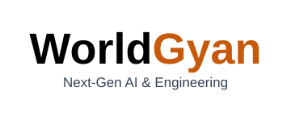

<!-- Preserved Cyber-Architect Midnight Cyan Theme for Ashutosh Kumar Choubey -->

  
  
  
  
  

**Established expertise:** Frontend architecture, Angular, TypeScript, RxJS and NgRx; enterprise UI engineering, component systems and automated testing.

**Currently building:** Public engineering studies and teaching examples in Angular, reactive workflows, state management and TypeScript.

**Exploring and researching:** AI architecture, Agentic AI, AI orchestration and LLM-powered applications; tool integration, evaluations and human review.

### Selected engineering projects

Public learning projects and code references, selected after reviewing their implementations.

- [**Angular architecture study**](https://github.com/AshutoshChoubey/angular-interview-worldgyan.com) — Study guides and TypeScript examples for Angular signals, HTTP interceptors, authentication flows and application architecture.

- [**RxJS operator lab**](https://github.com/AshutoshChoubey/rxjs-interview-worldgyan.com) — Angular demonstrations comparing switchMap, mergeMap, concatMap and exhaustMap, with a reactive search example.

- [**NgRx effects demo**](https://github.com/AshutoshChoubey/ngrxeffects) — An Angular PokéAPI example connecting store actions, reducers and HTTP side effects to list and detail views.

- [**TypeScript type-system examples**](https://github.com/AshutoshChoubey/typescript-interview-worldgyan.com) — Focused examples of generics, unions, mapped types and utility types, alongside a type-system study reference.

 

- [Frontend system design](https://worldgyan.com/technology/frontend-system-design/) — Micro-frontends, integration boundaries and enterprise scaling tradeoffs.
- [AI engineering research](https://worldgyan.com/technology/production-ai-engineering/) — Published research on architecture, retrieval, serving and evaluation.
- [Angular Testing — WorldGyan](https://www.youtube.com/playlist?list=PLqQyE6QNucSfUIpucL_nx7vDuwAa1A_VH) — Practical testing tutorials on the official YouTube channel.

[GitHub](https://github.com/AshutoshChoubey) · [LinkedIn](https://www.linkedin.com/in/ashutosh-kumar-choubey) · [Professional Portfolio](https://me.worldgyan.com/) · [WorldGyan](https://worldgyan.com/) · [YouTube](https://www.youtube.com/@WorldGyan)
