<!-- Preserved Cyber-Architect Midnight Cyan Theme for Ashutosh Kumar Choubey -->

# Cyber-Architect

[Main profile](../../README.md)

**Ashutosh Kumar Choubey · Senior Software Engineer** 
Frontend Architecture · System Design · AI Orchestration

  
  
  
  
  

**Established expertise:** Frontend architecture, Angular, TypeScript, RxJS and NgRx; enterprise UI engineering, component systems and automated testing.

**Currently building:** Public engineering studies and teaching examples in Angular, reactive workflows, state management and TypeScript.

**Research focus:** Retrieval, tool-using language models, workflow evaluation and human review.

### Selected engineering projects

[Angular architecture study repository](https://github.com/AshutoshChoubey/angular-interview-worldgyan.com)

[RxJS operator lab repository](https://github.com/AshutoshChoubey/rxjs-interview-worldgyan.com)

[NgRx effects demo repository](https://github.com/AshutoshChoubey/ngrxeffects)

[TypeScript type-system examples repository](https://github.com/AshutoshChoubey/typescript-interview-worldgyan.com)

- **Frontend System Design** · Micro-frontends · [Read research paper](https://worldgyan.com/technology/frontend-system-design/)
- **Agentic AI Engineering** · AI orchestration, retrieval, and evaluations · [Read research paper](https://worldgyan.com/technology/production-ai-engineering/)
- **Angular Testing Tutorials** · Unit testing and integration testing · [Watch video series](https://www.youtube.com/playlist?list=PLqQyE6QNucSfUIpucL_nx7vDuwAa1A_VH)

### Find me online

  
  
  
  
  

