# Obsidian Architect

[Main profile](../../README.md) · [Classic Engineering Minimal](../classic-engineering/README.md) · [Cyber-Architect](../cyber-architect/README.md)

**Ashutosh Kumar Choubey · Senior Software Engineer** 
Frontend Architecture · System Design · AI Orchestration

  
  
  
  
  

[Angular architecture study](https://github.com/AshutoshChoubey/angular-interview-worldgyan.com) — Guides and examples for signals, interceptors and application architecture.

  

[RxJS operator lab](https://github.com/AshutoshChoubey/rxjs-interview-worldgyan.com) — Angular examples for higher-order mapping and reactive search.

  

[NgRx effects demo](https://github.com/AshutoshChoubey/ngrxeffects) — An Angular PokéAPI example connecting actions, reducers and HTTP effects.

[TypeScript type-system examples](https://github.com/AshutoshChoubey/typescript-interview-worldgyan.com) — Generics, unions, mapped types and utility types.

<picture>
  <source media="(prefers-reduced-motion: reduce)" srcset="../main/assets/github-jet-static.svg">
  
</picture>
<picture>
  <source media="(prefers-reduced-motion: reduce)" srcset="../main/assets/contribution-snake-static.svg">
  
</picture>

  
  
  
  
  
  

